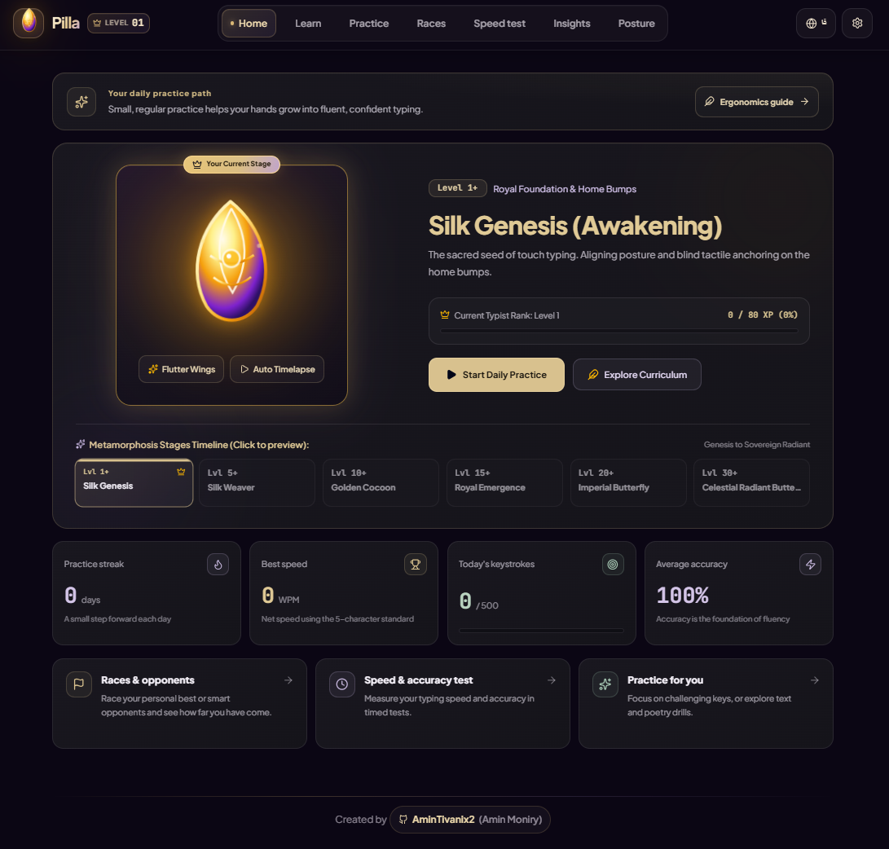
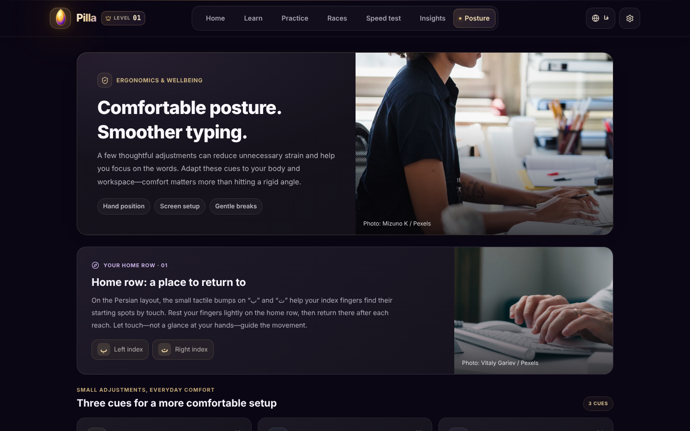
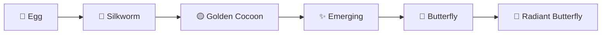

<div align="center">


<br/>


<br/>

<a href="https://github.com/Amin-Moniry/Pilla/releases/latest"></a>
<a href="https://nodejs.org/"></a>
<a href="https://react.dev/"></a>
<a href="https://vite.dev/"></a>
<a href="https://github.com/Amin-Moniry"></a>


<br/><br/>

> **"What the caterpillar calls the end of the world, the master calls a butterfly."**


</div>

<div align="center">

## `◈` Quick Install — Windows


</div>

You do **not** need to install anything developer-related to use Pilla. Just grab the ready-made `.exe`:

 &nbsp; Go to the **[Releases page](https://github.com/Amin-Moniry/Pilla/releases/latest)** (or click the **DOWNLOAD** badge above)

 &nbsp; Under **Assets**, download the latest Pilla `.exe` file

 &nbsp; Double-click the file to install / launch it, then start typing

> ⚠️ **Heads-up:** the `.exe` is not code-signed, so Windows SmartScreen (or your antivirus) may show a warning the first time. Click **More info → Run anyway**. This is normal for unsigned open-source apps.

<sub>Prefer running from source, or on macOS / Linux? See [Run From Source](#-run-from-source) below.</sub>

<br/>

<div align="center">


## `◈` Overview

</div>

<div align="center">

**Pilla** (Persian: **پیلا**) is a bilingual touch-typing tutor that teaches you to type fast **without looking at the keyboard** — in **Persian** (ISIRI 9147) and **English** (US QWERTY).

Your progress is wrapped in a metaphor: you start as an egg, spin a golden cocoon, and finally spread your wings. Every lesson, drill, race and test earns XP that evolves your butterfly avatar — so practice feels like growth, not homework.

Everything runs **locally on your machine**. No account, no sign-up, no cloud — your progress is saved on your own device.

</div>

<br/>

<div align="center">


## `◈` Screenshots


<br/>



<sub>▶ Home dashboard in **Persian (فارسی)** — right-to-left layout, level, XP and your evolving butterfly</sub>

<br/><br/>



<sub>▶ Ergonomics &amp; posture guide in **English** — left-to-right layout</sub>

</div>

<br/>

<div align="center">


## `◈` Key Features


<small>

| <sub>▶ Feature</sub> | <sub>Description</sub> | <sub>Status</sub> |
|:---:|:---:|:---:|
| <sub>150-lesson curriculum</sub> | <sub>A full track for Persian and another for English — roughly 30 hours each, organized into 11 stages from posture to master exams</sub> | <sub>✅</sub> |
| <sub>Bilingual interface</sub> | <sub>Switch between English and Persian any time; the whole UI flips between LTR and RTL</sub> | <sub>✅</sub> |
| <sub>Virtual keyboards</sub> | <sub>Persian ISIRI 9147 and US QWERTY, with Dvorak and Colemak layouts also mapped</sub> | <sub>✅</sub> |
| <sub>Hands overlay</sub> | <sub>On-screen finger zones and home-row bump indicators show which finger presses which key</sub> | <sub>✅</sub> |
| <sub>Butterfly metamorphosis</sub> | <sub>XP and levels evolve your avatar from egg → silkworm → cocoon → emerging → butterfly → radiant butterfly</sub> | <sub>✅</sub> |
| <sub>Multi-step lessons</sub> | <sub>Learn → Watch → Guided → No-keyboard drills → Test; the sequence adapts per lesson</sub> | <sub>✅</sub> |
| <sub>Adaptive practice</sub> | <sub>Targeted practice studio with categories and custom practice texts</sub> | <sub>✅</sub> |
| <sub>Races</sub> | <sub>Race against AI bots of different speeds, or against the ghost of your personal best</sub> | <sub>✅</sub> |
| <sub>Speed test</sub> | <sub>Timed tests with a certificate at the end</sub> | <sub>✅</sub> |
| <sub>Stats &amp; insights</sub> | <sub>WPM, CPM, accuracy and consistency tracking, daily streaks, achievements, JSON export of your progress</sub> | <sub>✅</sub> |
| <sub>Persian typing done right</sub> | <sub>Proper ZWNJ (نیم‌فاصله) handling, classical poetry packs and formal writing</sub> | <sub>✅</sub> |
| <sub>Code practice</sub> | <sub>English track includes symbols and code-style snippets</sub> | <sub>✅</sub> |
| <sub>Ergonomics guide</sub> | <sub>Posture, screen setup and gentle-break advice, with home-row guidance</sub> | <sub>✅</sub> |
| <sub>Synthesized sounds</sub> | <sub>Zero-latency Web Audio keyboard sounds (Cherry MX Blue, Thock, Typewriter, Bubble) plus soft background piano</sub> | <sub>✅</sub> |
| <sub>Offline-friendly (PWA)</sub> | <sub>Service worker caching and web manifest included</sub> | <sub>✅</sub> |
| <sub>Real-time multiplayer lobbies</sub> | <sub>WebSocket lobbies to race real people</sub> | <sub>⏳</sub> |
| <sub>Custom sound-pack recorder</sub> | <sub>Record and use your own keystroke sounds</sub> | <sub>⏳</sub> |

</small>

</div>

<br/>

<div align="center">


## `◈` The Butterfly Journey

</div>



<div align="center">

### Curriculum at a glance

<small>

| <sub>Stage focus</sub> | <sub>What you practice</sub> |
|:---:|:---:|
| <sub>Posture &amp; anchors</sub> | <sub>Sitting, hand placement, finding the home-row bumps by touch</sub> |
| <sub>Home, top &amp; bottom rows</sub> | <sub>Two keys at a time — an intro lesson plus a deep-drill lesson per key</sub> |
| <sub>One-hand &amp; alternating hands</sub> | <sub>Left-only, right-only, then smooth hand alternation</sub> |
| <sub>Bigrams &amp; trigrams</sub> | <sub>Common letter combinations for flow</sub> |
| <sub>Shift, ZWNJ &amp; punctuation</sub> | <sub>Capitals, half-spaces and punctuation marks</sub> |
| <sub>Numbers &amp; symbols</sub> | <sub>Digits, symbols and code (English) / diacritics and formal writing (Persian)</sub> |
| <sub>Speed building &amp; real texts</sub> | <sub>Longer passages, then three master exams</sub> |

</small>

</div>

<sub>Lessons unlock one after another. A toggle on the roadmap screen unlocks them all if you want to jump around.</sub>

<br/>

<div align="center">


## `◈` Run From Source


</div>

**Prerequisites:** [Node.js](https://nodejs.org/) **20.19+** (or 22.12+) and npm. No API keys, no `.env` file, no backend.

 &nbsp; Clone the repository

```bash
git clone https://github.com/Amin-Moniry/Pilla.git
cd Pilla
```

 &nbsp; Install dependencies

```bash
npm install
```

 &nbsp; Start the dev server

```bash
npm run dev
```

Open **http://localhost:3000** in your browser — that's it.

 &nbsp; *(Optional)* Create a production build

```bash
npm run build      # outputs to dist/
npm run preview    # serve the production build locally
```

### Useful commands

<small>

| <sub>Command</sub> | <sub>What it does</sub> |
|:---|:---|
| <sub>`npm run dev`</sub> | <sub>Start the Vite dev server on port 3000</sub> |
| <sub>`npm run build`</sub> | <sub>Create an optimized production build in `dist/`</sub> |
| <sub>`npm run preview`</sub> | <sub>Preview the production build locally</sub> |
| <sub>`npm test`</sub> | <sub>Run the typing-engine and storage unit tests</sub> |
| <sub>`npm run lint`</sub> | <sub>TypeScript type check (`tsc --noEmit`)</sub> |
| <sub>`npm run clean`</sub> | <sub>Remove the `dist/` folder</sub> |
| <sub>`npm run electron:dev`</sub> | <sub>Build the site and open it in a desktop (Electron) window</sub> |
| <sub>`npm run dist:win`</sub> | <sub>Build the Windows installer into `release/`</sub> |

</small>

### Build the Windows installer yourself

```bash
npm install
npm run dist:win
```

The installer is created in `release/` as `Pilla-Setup-<version>.exe` (installer wizard with install-folder choice, desktop and Start Menu shortcuts). Building on Windows works out of the box; on Linux/macOS you additionally need [Wine](https://www.winehq.org/).

<br/>

<div align="center">


## `◈` How Speed Is Measured

</div>

Pilla uses the international **5-character word** standard for both Persian and English, so speeds are comparable across languages (spaces, ZWNJ and punctuation all count as keystrokes):

```
Gross WPM = (Total Keystrokes / 5) / Minutes
Net WPM   = max(0, Gross WPM − Uncorrected Errors / Minutes)
```

<br/>

<div align="center">


## `◈` Tech Stack

| Layer | Technology |
|:-----:|:----------:|
| **Language** | TypeScript |
| **UI framework** | React 19 |
| **Build tool** | Vite |
| **Desktop shell** | Electron + electron-builder (NSIS installer) |
| **Styling** | Tailwind CSS 4 |
| **Animation** | Motion |
| **Icons** | Lucide |
| **Effects** | canvas-confetti |
| **Audio** | Native Web Audio API (synthesized) |
| **Persistence** | Browser `localStorage` |
| **Tests** | Node test runner via `tsx` |

</div>

<br/>

<div align="center">


## `◈` System Requirements

<small>

| <sub>Component</sub> | <sub>Windows .exe</sub> | <sub>Run from source</sub> |
|:---:|:---:|:---:|
| <sub>OS</sub> | <sub>Windows 10 / 11 (64-bit)</sub> | <sub>Windows, macOS or Linux</sub> |
| <sub>Node.js / npm</sub> | <sub>Not required</sub> | <sub>Node.js 20.19+ or 22.12+</sub> |
| <sub>Internet</sub> | <sub>Optional — only used to load web fonts</sub> | <sub>Needed once for `npm install`</sub> |

</small>

</div>

<br/>

<div align="center">


## `◈` Project Structure

</div>

```
Pilla/
├── index.html
├── package.json
├── vite.config.ts
├── tsconfig.json
├── electron/                 # Desktop app entry (main process)
├── build/                    # App icon + installer artwork
├── screenshots/              # Images used in this README
├── public/
│   ├── audio/                # Background piano + attribution
│   ├── images/               # Ergonomics photos + credits
│   ├── manifest.json         # PWA manifest
│   └── sw.js                 # Service worker
└── src/
    ├── App.tsx               # App shell, tabs, language switching
    ├── index.css             # Theme and component styles
    ├── components/           # Dashboard, Learn, Practice, Races, Test,
    │                         # Stats, Posture, Keyboard, TypingArena, Settings
    ├── data/curriculum/      # 150-lesson specs, word & text banks (Fa / En)
    ├── types/                # Typing & curriculum schemas
    └── utils/                # Typing engine, finger mapping, sound,
                              # storage, achievements, metamorphosis
```

<sub>Want to add or tweak a lesson? Edit the spec lists in `src/data/curriculum/specsEn.ts` or `specsFa.ts`. Each track must contain exactly **150 lessons** — the builder throws an error otherwise.</sub>

<br/>

<div align="center">


## `◈` Troubleshooting


</div>

**Windows shows a "protected your PC" warning**
```
Click "More info" → "Run anyway". The .exe is not code-signed.
```

**`npm install` or `npm run dev` fails**
```bash
node -v            # must be 20.19+ (or 22.12+)
rm -rf node_modules package-lock.json && npm install
```

**Port 3000 is already in use**
```bash
npm run dev -- --port=3001
```

**Fonts look different when offline**
```
Pilla loads Vazirmatn, Plus Jakarta Sans and JetBrains Mono from Google Fonts.
Offline, the system falls back to default fonts — everything still works.
```

**My progress disappeared**
```
Progress lives in the app's local storage on this device. Clearing browser
data (or moving to a new browser/machine) resets it. Use the JSON export in
the Insights tab to back it up.
```

<br/>

<div align="center">


## `◈` FAQ

<small>

| <sub>Question</sub> | <sub>Answer</sub> |
|:---|:---|
| <sub>**Do I need an account?**</sub> | <sub>No. Everything is local — no sign-up, no cloud.</sub> |
| <sub>**Is my data uploaded anywhere?**</sub> | <sub>No. Progress and settings stay in your device's local storage.</sub> |
| <sub>**Which languages can I learn?**</sub> | <sub>Persian (ISIRI 9147) and English (US QWERTY).</sub> |
| <sub>**Can I switch language later?**</sub> | <sub>Yes — use the language button in the top bar at any time.</sub> |
| <sub>**Does it sync between devices?**</sub> | <sub>Not automatically. Export your progress as JSON to move it.</sub> |
| <sub>**Can I race other people online?**</sub> | <sub>Not yet — real-time lobbies are on the roadmap. Today you race AI bots and your own ghost.</sub> |

</small>

</div>

<br/>

<div align="center">


## `◈` Roadmap

</div>

- [x] Core typing engine with unit tests
- [x] Persian ISIRI 9147 & QWERTY virtual keyboards
- [x] Hands overlay with finger zones & home-bump indicators
- [x] Butterfly metamorphosis avatar & XP system
- [x] Multi-step lessons (Learn → Watch → Guided → Free → Test)
- [x] Classical Persian poetry & code practice packs
- [x] AI bot races & personal-best ghost racing
- [x] PWA offline caching & manifest
- [x] Windows `.exe` release
- [ ] WebSocket real-time multiplayer lobbies
- [ ] Custom user sound-pack recorder

<br/>

<div align="center">


## `◈` Contributing

1. Fork the repo
2. Create a branch: `git checkout -b feature/your-idea`
3. Commit: `git commit -m 'feat: description'`
4. Push: `git push origin feature/your-idea`
5. Open a Pull Request

<br/>


## `◈` Credits

</div>

- Ergonomics workstation photo: *“Woman Working on a Computer in an Office”* by Mizuno K, [Pexels](https://www.pexels.com/photo/woman-working-on-a-computer-in-an-office-12911961/)
- Home-row typing photo: *“Close-up of Hands Typing on a Keyboard”* by Vitaly Gariev, [Pexels](https://www.pexels.com/photo/close-up-of-hands-typing-on-a-keyboard-30535780/)
- Background music: see [`public/audio/ATTRIBUTION.md`](public/audio/ATTRIBUTION.md)

<br/>

<div align="center">


## `◈` Creator

<br/>


<br/>

<table>
<tr>
<td align="center" width="210">
<a href="https://github.com/Amin-Moniry">

</a>
</td>
<td align="center" width="210">
<a href="https://github.com/Amin-Moniry/Pilla/releases/latest">

</a>
</td>
<td align="center" width="210">
<a href="https://github.com/Amin-Moniry/Pilla/issues">

</a>
</td>
</tr>
</table>

⭐ **If Pilla helps you type faster, drop a star!**

<br/>


<br/>


</div>
